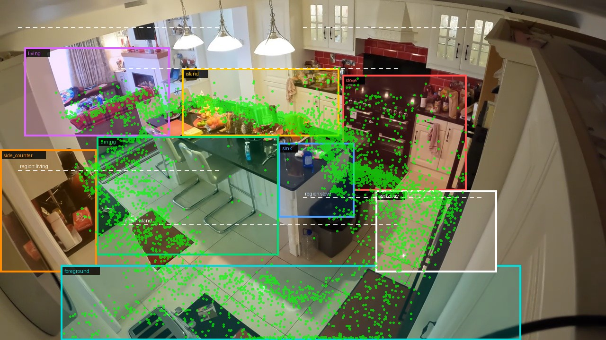

# Hệ thống truy vấn ảnh theo mô tả + metadata

Gõ mô tả (tiếng Việt hoặc tiếng Anh) → trả về ảnh liên quan trong bộ 5000 ảnh. Nếu câu có nhắc
**giờ / buổi / ngày / địa điểm** thì kết quả được **lọc đúng** theo metadata; nếu nhắc **đồ vật, số người**
thì ưu tiên ảnh có đúng số lượng đó.

```
"ba người đang nấu ăn lúc 12 giờ trưa"
   → nội dung: "ba người đang nấu ăn" · giờ: 12:00–12:59 · đồ vật: person==3
```

## 0. Nâng cấp theo đặc điểm bộ ảnh (phân tích Batch 1–3)

Xem trực tiếp ảnh + thống kê `metadata.csv` / `detections.json` cho thấy bộ ảnh rất đặc thù:

| Quan sát | Hệ quả với bản cũ | Nâng cấp |
|---|---|---|
| Cả 5000 ảnh từ **1 camera cố định** (góc trên, mắt cá) quay **1 căn bếp** từ 8h–20h | CLIP toàn ảnh thấy mọi ảnh gần như giống nhau (cosine trung bình giữa 2 ảnh bất kỳ = **0.85**) | **CLIP từng người** (cắt theo khung YOLO) + **CLIP vùng cắt** (đảo bếp, bếp nấu, phòng khách) |
| Người chỉ chiếm ~3% diện tích ảnh; mỗi toạ độ luôn là 1 chỗ cố định trong phòng | Không trả lời được "người đứng ở bếp nấu", "ngồi ở sofa" | **Vùng trong bếp**: điểm chân của từng người → bếp nấu / bồn rửa / sau đảo bếp / bàn ăn / phòng khách / quầy trái / gần camera / lối đi |
| ~15% câu mô tả chỉ tả nội thất ("white cabinets, red backsplash, black countertop") | Embedding mô tả bị kéo về 1 chỗ (cos trung bình **0.90**) | **Bỏ câu nền** + **embed từng câu**, lấy câu khớp nhất |
| YOLO thấy bàn ăn 85%, sofa 77%, ghế 75%, lò 69% số ảnh (nội thất) | "có sofa", "bồn rửa" cộng điểm gần như ngẫu nhiên | **Bỏ qua đồ vật cố định** khi cộng điểm (có ghi chú cho người dùng) |
| Ảnh cách nhau ~10 giây | Top-20 bị lấp bởi các khung hình gần trùng | **Gộp khung hình liền kề** (< 30s) — kết quả đa dạng hơn, hiện "+n khung liền kề" |
| Nhiều người xuất hiện lặp lại cả ngày | — | **Tìm người này**: bấm vào 1 người → các ảnh khác có người ngoại hình giống |



*Khung màu = vùng (scene.zones), chấm xanh = điểm chân của người YOLO tìm thấy, nét đứt = vùng cắt cho CLIP.*
Vùng **bếp nấu** và **bồn rửa** đã được đối chiếu với mô tả: ảnh mà mô tả nói "at the stove" có người trong
vùng bếp nấu 60% (so với 18% ở ảnh còn lại); "washing dishes / at the sink" → 39% so với 13%.

Ví dụ câu hỏi mới:
```
hai người đứng ở bếp nấu lúc 12 giờ trưa      → vị trí: bếp nấu ≥2 · giờ 12:00–12:59
người áo xanh dương đang rửa bát               → vị trí: bồn rửa · màu áo: blue · + CLIP từng người
không có ai ở bếp nấu vào buổi chiều           → bếp nấu == 0 người (chỗ khác có thể có)
someone sitting on the couch in the evening   → vị trí: phòng khách/sofa
```

### Cần build thêm (trên máy của bạn)

```bash
python scripts/build_index.py --stages text,crops
```
- `text` (~3–6 phút CPU): embed lại mô tả đã bỏ câu nền + từng câu (~15k câu).
- `crops` (~10–15 phút CPU): CLIP cho ~12k người + 3 vùng × 5000 ảnh. Cần `detections.json` (đã có).
Chưa build thì hệ thống **vẫn chạy**: vùng, gộp khung hình, bỏ qua đồ vật cố định dùng ngay `detections.json`;
phần nào thiếu sẽ hiện cảnh báo ở thanh bên của giao diện.

So sánh trước/sau: `python eval/evaluate.py --compare` (chạy cả cấu hình tắt phần scene để đối chiếu).
Thử nhanh không cần model (TF-IDF, 400 truy vấn): so khớp theo từng câu nâng self-retrieval Recall@10 từ ~0.59 lên
~0.65, MRR ~0.40 → ~0.44. (Riêng việc bỏ câu nền thì TF-IDF gần như không đổi vì IDF đã tự giảm trọng số từ phổ
biến — phần này chủ yếu có ích cho embedding e5, hãy kiểm bằng `--compare` sau khi build.) Phần CLIP người/vùng
chưa đo được ở đây vì cần tải model — chạy `--compare` trên máy để xem.

## 0b. Nâng cấp nhận diện: đồ vật · tư thế · đang cầm gì (PA1 + PA2)

Trước đây phần nhận diện đồ vật chỉ có YOLO11 (80 lớp COCO): **không có nồi, chảo, thớt, đĩa**, còn dao / điện thoại
có lớp nhưng quá nhỏ nên **0 lần** nhận ra trên 5000 ảnh. Màu áo lấy từ 1 ô cố định trong khung người nên hay trúng đầu
(camera nhìn từ trên xuống) và áo navy bị gán "đen".

| Phần | Làm gì | Sinh ra | Công tắc trong `config.yaml` |
|---|---|---|---|
| **PA1 — CLIP theo vùng** | So embedding vùng đã cắt sẵn (bếp nấu, đảo bếp) với câu "a pot on the stove" / "an empty stove" | `clip_tags.npz` (vài giây) | `objects.clip_tags.enabled` |
| **PA2 — YOLOE** | Detector nhận lớp bằng chữ, chạy trên vùng làm việc phóng to: dao, nồi, chảo, thớt, đĩa, cốc, điện thoại | `objects.json` | `objects.yoloe.enabled` |
| **PA2 — YOLO-pose** | Khung xương → tư thế (đứng/ngồi/cúi), vùng thân áo theo vai–hông (sửa màu áo), vị trí cổ tay | `pose.json` | `pose.enabled`, `colors.source: pose\|box` |
| **PA2 — bàn tay** | Cắt ô quanh cổ tay → CLIP "a hand holding a knife" vs "an empty hand" + khung YOLOE ngay chỗ tay | `hands_*.npy` | `hands.enabled` |

Câu hỏi có/không ("có nồi") lấy **trung bình 2 nguồn** YOLOE + CLIP vùng: hai nguồn cùng nói có thì điểm cao, một
nguồn thì nửa điểm — đỡ nhận nhầm. Mỗi phần **tắt bằng 1 dòng** (`enabled: false`) không cần build lại; tắt hết thì kết
quả **giống hệt bản cũ** (có test kiểm tra). File cũ trong `artifacts/` không bị ghi đè.

```bash
python scripts/build_index.py --stages tags,objects,pose,hands   # CPU ~1 giờ, chỉ chạy 1 lần
python eval/evaluate.py --ablation                               # so sánh bật/tắt từng phần
```
Model nằm sẵn trong `weights/` (YOLOE-26s, YOLO26s-pose; tên lớp YOLOE đã tính sẵn embedding trong
`weights/yoloe_text_emb.pt` nên **không cần cài thêm gói** nào). `weights/mobileclip2_b.ts` chỉ cần khi đổi danh sách
lớp YOLOE (kèm `pip install git+https://github.com/ultralytics/CLIP.git`).

Câu hỏi mới:
```
người cầm dao lúc 16h              → cầm dao (YOLOE ở bàn tay + CLIP bàn tay) · giờ 16
người đang cắt rau trên thớt       → thớt (YOLOE + CLIP vùng) · cầm dao (ngầm hiểu từ "cắt", trọng số 0.5)
có nồi trên bếp buổi tối           → nồi: điểm có mặt từ YOLOE + CLIP vùng
hai người đang ngồi                → tư thế ngồi ≥ 2 (khung xương)
someone holding a phone            → cầm điện thoại
```

Thử trên 48 ảnh mẫu: YOLOE trên vùng phóng to bắt thớt 3 → 23 lần, dao 1 → 7, nồi 30 → 55 so với chạy cả ảnh;
màu áo theo pose đổi màu chính của 39/157 người (áo navy trước bị "đen" nay ra "xanh dương").
Hạn chế: luật tư thế còn thô (camera trên cao làm đùi trông ngắn) nên trọng số thấp (`posture_bonus: 0.10`);
dao nằm trên bàn không ai cầm vẫn hay sót; ngưỡng CLIP vùng tự chọn (Otsu) — nên kiểm ~50 ảnh rồi đặt
`objects.clip_tags.thresholds` nếu cần.

## 0c. Đề KIS dài, cho thêm gợi ý mỗi 30 giây (sau buổi test 23/11)

Buổi test 23/11 lộ ra: **thêm gợi ý lại làm kết quả tệ hơn** (câu phụ nữ cầm điện thoại: hạng 1 → 12 → ngoài top 500),
CLIP gần như mù với câu tiếng Việt dài, và đáp án lệch 63 giây bị chấm sai. Đáp án 4 câu đã tìm lại bằng mắt và thêm
vào `eval/queries.kis.jsonl`.

| Vấn đề | Nguyên nhân đo được | Sửa |
|---|---|---|
| Câu "Không có ai khác", "Lúc đó là buổi chiều" kéo ảnh đúng từ hạng 3 xuống 575 | các câu này bị đem so nghĩa như mô tả ảnh; "không có ai" bị hiểu là bếp trống | Parser: "không có ai khác" = đúng 1 người; câu chỉ còn từ rỗng không đem so nghĩa |
| Điểm thưởng sai đè điểm ngữ nghĩa | "áo len kem và **váy đen**" → áo đen; "khăn **màu cam**" → quả cam | Màu váy không tính là màu áo, thêm màu kem; "màu cam" không phải quả cam; "áo thể thao" |
| "Đứng ở góc dưới bên trái khung hình" bị bỏ qua | chưa hiểu vị trí trong khung hình | `frame_pos`: thưởng ảnh có người ở đúng phần khung hình |
| CLIP xếp ảnh đúng hạng 900–3000 | CLIP + mô tả ảnh là tiếng Anh | **Dịch truy vấn VI→EN** (`translation`, VietAI/envit5 + bảng thuật ngữ của bếp, cache theo câu) |
| Câu gợi ý sau (chi tiết phụ) làm loãng câu đầu | trung bình đều các câu | `long_query.first_weight: 2` — câu đầu nặng gấp đôi |
| Tả 2 người trong 1 ảnh, chỉ tìm được 1 người | điểm "từng người" chỉ lấy người khớp nhất | **Rerank top-300**: ghép mỗi người/vật được tả với 1 người khác nhau hoặc 1 vùng cắt (Hungarian) |
| Tìm đúng sự kiện nhưng nộp nhầm khung | 20–40 khung liền nhau gần như giống hệt | Gộp khung 90s; cửa sổ chi tiết hiện **các khung cùng sự kiện xếp theo điểm, mỗi khung có nút Nộp** |
| Mỗi gợi ý mới chậm | mã hoá lại cả đoạn dài | Cache embedding từng câu; vector cả đoạn = trung bình vector các câu → mỗi gợi ý chỉ tốn cho câu mới |

Đo (13 đề có đáp án, chấm lại sau mỗi câu gợi ý):  `python eval/evaluate.py --hints`

| | Bản cũ | Bản mới |
|---|---|---|
| Đúng khung — MRR mọi lượt gợi ý | 0.157 | 0.233 |
| Đúng khung trong top 20 khi đủ gợi ý | 23% | 46% |
| Nhóm khung (90s) chứa đáp án trong top 10 / top 20 khi đủ gợi ý | 38% / 62% | 54% / 85% |
| 4 đề 23/11, hạng sau từng gợi ý | 02: 1→12→502 · 03: 1171→372 · 04: …→256 · 05: 4→110→336→575→227 | 02: 1→1→2 · 03: 815→387 (nhóm: 13) · 04: …→18 · 05: 3→56→56→4→1 |

Chỉ có 13 đề nên chênh lệch nhỏ giữa các tham số là nhiễu; hãy thêm đề + đáp án sau mỗi buổi thi vào
`eval/queries.kis.jsonl` rồi chạy lại `--hints`.

Độ trễ trên laptop i5 4 nhân (CPU): ~2–4 giây cho mỗi câu gợi ý mới (dịch ~1–3 giây), câu cũ ~0.2 giây.
Tắt dịch ở thanh bên nếu cần nhanh hơn. Cần `pip install sentencepiece`; model dịch tự tải lần đầu (~1 GB).

## 1. Cài đặt & chạy

```bash
python -m venv .venv && .venv\Scripts\activate        # Windows (macOS/Linux: source .venv/bin/activate)
pip install -r requirements.txt
```

Đặt dữ liệu:

```
data/
  metadata.csv            # file 5000 dòng (đã có sẵn)
  images/
    Batch1/  08_509.jpg ...
    Batch2/  ...
    Batch3/  ...
```

Tên ảnh `HH_frame.jpg` được tự ghép với `imageID` (`08_509.jpg` → `day1_Kitchen_08_509`). Ảnh đặt trong
thư mục con nào cũng được (quét đệ quy). Muốn để ảnh chỗ khác thì sửa `paths.image_root` trong `config.yaml`
hoặc đặt biến môi trường `IMAGE_ROOT` (chỉ cho máy của bạn, không phải sửa config).

```bash
python scripts/build_index.py          # build 1 lần: mô tả + CLIP + YOLO + CLIP ảnh cắt (người, vùng)
                                       # CPU ~30–45 phút lần đầu, GPU vài phút. Lưu vào artifacts/
streamlit run app/streamlit_app.py     # giao diện web
python scripts/search.py -i            # hoặc gõ ở terminal
```

Chưa muốn tải model? `python scripts/build_index.py --offline` dùng TF-IDF (chỉ hợp truy vấn tiếng Anh)
để thử luồng chạy.

## 1b. Nộp bài lên DRES (cuộc thi Castle5000)

Theo tài liệu *Hướng dẫn sử dụng DRES* của BTC. Máy chủ: `https://dres.2hbread.com/api/v2`, collection `castle5000`.

**1. Đặt tài khoản** (BTC gửi riêng, **không commit**): chép `.env.example` thành `.env` rồi điền

```
DRES_USERNAME=UIA_TenCuaBan
DRES_PASSWORD=MatKhauCuaBan
DRES_EVALUATION_ID=            # bỏ trống = tự lấy buổi thi đang ACTIVE
```
Không muốn lưu mật khẩu? Bỏ trống `.env` và nhập ở thanh bên của giao diện (hoặc dán Session ID từ trang Profile).

**2. Kiểm tra trước giờ thi** (checklist mục 9.1): đăng nhập, liệt kê buổi thi, task đang chạy, đổi tên ảnh

```bash
python scripts/dres_submit.py check
```

**3. Nộp bài** — 3 cách, cùng dùng `src/retrieval/submit/dres.py`. Có 2 loại task: **KIS** nộp *tên ảnh*,
**QA** nộp *câu trả lời bằng chữ* (mục 8 tài liệu). Hệ thống đọc `taskType` của task đang chạy để biết là loại nào
và cảnh báo khi nộp nhầm loại (DRES sẽ trả 412).

| Cách | Task KIS (ảnh) | Task QA (đáp án chữ) |
|---|---|---|
| Giao diện | Thanh bên → **Nộp bài DRES** → Đăng nhập. Dưới mỗi ảnh có nút **Nộp**; trong *Xem chi tiết* có **Nộp ảnh này lên DRES**; hoặc ô *Nộp theo mã ảnh*. | Trang **Hỏi đáp**: dưới câu trả lời có ô *Đáp án nộp lên DRES* điền sẵn đáp án ngắn (sửa được) + nút **Nộp đáp án**; hoặc ô *Nộp đáp án chữ (QA)* ở thanh bên. |
| Dòng lệnh | `python scripts/dres_submit.py submit 10_1528.jpg` | `python scripts/dres_submit.py answer 3` · `answer "áo đỏ"` |
| REST API | `POST /dres/submit/{image_id}` | `POST /dres/answer` với body `{"text": "3"}` |

Chung: `POST /dres/login` · `GET /dres/status` (có `task_kind`: `KIS`/`QA`) · `GET /dres/history`.
`python scripts/dres_submit.py -i` gõ liên tục, tự nộp ảnh hay chữ theo loại task đang chạy.
**Bấm Nộp là gửi ngay, không hỏi xác nhận** — điểm tính cả thời gian nộp. Hộp hiện ra sau đó chỉ báo kết quả.
Dòng lệnh cũng nộp ngay; thêm `--confirm` nếu muốn hỏi [y/N] trước mỗi lần nộp.

Riêng task QA:
- Body chỉ có `{"text": ...}`, **không** kèm tên ảnh. Đáp án tự cắt dấu cách thừa.
- DRES thường trả **202 `CHỜ CHẤM`** (INDETERMINATE) — trọng tài chấm sau, điểm tính theo lúc nộp, không cần nộp lại.
- Viết **ngắn gọn, chỉ đáp án** (`3`, `red`), theo ngôn ngữ câu hỏi. `3` và `3 người` là **2 lần nộp khác nhau** —
  mỗi đáp án bị chấm sai đều bị trừ điểm, đừng nộp nhiều đáp án để thử — sửa ô đáp án cho đúng trước khi bấm Nộp.
- Được nộp nhiều lần: đáp án y hệt đã nộp vẫn được gửi lại (nếu DRES trả 412 *Duplicate* thì hiện nhãn `TRÙNG`).

- Tên ảnh tự đổi về dạng DRES: `10_1528.jpg` / đường dẫn ảnh → `day1_Kitchen_10_1528` (= cột `imageID`).
- Session hết hạn (401) → **tự đăng nhập lại** rồi nộp lại 1 lần.
- **Được nộp nhiều lần** trong 1 task, kể cả nộp lại ảnh / đáp án cũ — client không chặn, lần nào bấm cũng gửi.
- Kết quả đọc theo bảng 7.3 + 8.6: `ĐÚNG` / `SAI` / `CHỜ CHẤM` / `CHƯA CÓ TASK` (400 wrong state) / `SAI TÊN` /
  `HẾT PHIÊN` / `SAI BUỔI THI` / `NHẦM LOẠI BÀI` / `TRÙNG` / `BỊ TỪ CHỐI` (412). Thanh trên kết quả hiện task đang
  chạy (KIS/QA), số lần nộp, số lần sai, số đáp án đang chờ chấm.
- Mọi lần nộp được ghi vào `artifacts/dres_submissions.jsonl` (không ghi mật khẩu / session).
- Thử kết nối an toàn: nộp khi **chưa có task chạy** → DRES trả 400 *wrong state* (không bị trừ điểm).

## 1c. Đề thi dạng đoạn nhiều câu (KIS / DRES)

Đề của BTC là một đoạn nhiều câu, có tên riêng và chi tiết về người khác trong ảnh. Bản cũ đọc sai cả đoạn: "**Một** người
đàn ông" bị hiểu là *đúng 1 người*, "những người khác **như đang** rửa chén" bị coi là chắc chắn có người ở bồn rửa, màu
áo của "thầy Linh" bị gắn với bồn rửa, và các điểm thưởng đó lấn át phần so khớp ngữ nghĩa. Đã sửa:

- "một người / a man" là mạo từ: tính *có ít nhất 1 người*. Muốn đúng 1 người thì viết "chỉ có một người" hoặc "một mình".
- "những người khác / other people": ảnh có >= 3 người.
- Câu phỏng đoán ("như đang", "có vẻ", "possibly"): điều kiện vùng trong câu đó chỉ được nửa điểm.
- Màu áo chỉ gắn với vùng nhắc **cùng câu**.
- Tên riêng ("Thầy Linh", "cô Hoa") được thay bằng "người đàn ông" / "người phụ nữ".
- Vùng mới **tủ lạnh** (góc phải, gần camera).
- Mỗi câu được chấm riêng rồi lấy trung bình, nên ảnh phải khớp tất cả các câu. Điểm thưởng của câu dài được nhân 0.5
  (`search.long_query` trong `config.yaml`).

Đo trên `eval/queries.kis.jsonl` (1 đề thật của BTC + 8 đề tự viết từ ảnh ngẫu nhiên): đề BTC từ hạng 1047 lên hạng 4.
Recall@10 tăng từ 0.11 lên 0.33, tính cả khung ±30s thì từ 0.11 lên 0.44. Bộ đề còn nhỏ: **mỗi lần thi xong, thêm đề +
đáp án vào file này** để đo lại.

So các cách chấm câu dài trên bộ đề (mất khoảng 3 phút):

```bash
python eval/evaluate.py --kis
```

`search.long_query.fusion` có 3 lựa chọn: `weighted` (mặc định), `max` và `mixed`. Trên 9 đề hiện có, `mixed` cho
nhiều đề lọt top 50 nhất (6/9 so với 4/9), nhưng làm đề BTC tụt từ hạng 4 xuống hạng 24. Vì vậy mặc định vẫn là
`weighted`. Khi có thêm đề thật, chạy lại lệnh trên rồi chọn.

Đã thử và **không dùng**: dịch đề sang tiếng Anh trước khi tìm. Bản dịch tay chuẩn cũng không tốt hơn đề tiếng Việt
(mô hình e5 và CLIP đều đa ngôn ngữ). Còn Qwen3-0.6B thì mất khoảng 30 giây mỗi đề trên CPU và dịch sai quần áo.

## 1d. Sổ tay trang phục (nhận diện quần áo)

CLIP nhỏ đang dùng (ViT-B/32) nhìn ảnh cắt từng người vẫn yếu về chi tiết quần áo: hay lẫn sọc với trơn, áo len
với sơ mi. Fine-tune thì không được, vì mô tả trong `metadata.csv` gần như không nhắc tới quần áo (không có dữ liệu
để dạy) và máy chỉ có CPU. Nhưng video chỉ có khoảng 15–20 người, mỗi người mặc nguyên 1 bộ cả ngày. Vì vậy:

1. Gom 12.408 lượt người thành 60 nhóm theo ngoại hình (CLIP cả người + CLIP phần thân trên).
2. Xem ảnh mẫu từng nhóm, ghi mô tả bộ đồ **một lần** vào `data/outfits.yaml`. Nhóm bị lẫn để `""`.
3. Khi tìm, mỗi câu có tả quần áo được so với các mô tả bằng model chữ e5. Người thuộc nhóm khớp được cộng
   điểm (thành phần `outfit`, trọng số `search.weights.outfit`). Khung bị che hay quay lưng vẫn mang nhãn nhóm.

```bash
python scripts/outfits.py build      # chỉ cần khi build lại bước crops; ~10 phút. Ảnh mẫu: artifacts/outfits/sheet_*.png
python scripts/outfits.py show       # các bộ đồ đã ghi nhãn + số người
python scripts/outfits.py try "người mặc áo len sọc ngang"   # câu này khớp bộ đồ nào
```

Sửa nhãn trong `data/outfits.yaml` thì chỉ cần mở lại app, không phải build lại. Hiện có 33/60 nhóm có nhãn
(28 bộ đồ, 4.917/12.408 lượt người). Nếu build lại mà các nhóm chia khác đi, app sẽ cảnh báo và tắt sổ tay cho tới
khi ghi nhãn lại.

Kết quả trên 9 đề nhiều câu (`python eval/evaluate.py --kis`):

| | MRR | Lọt top 50 | Hạng đề BTC |
|---|---|---|---|
| Không có sổ tay | 0.160 | 4/9 | 4 |
| Có sổ tay (`outfit: 0.20`) | **0.189** | **5/9** | **1** |

Hạng từng đề: [4,36,406,61,1,88,493,212,8] → [1,9,318,43,27,85,462,97,2]. Đề 18_3001 tụt từ 1 xuống 27: người đàn
ông áo thun trắng trong đề thuộc một nhóm bị lẫn (không có nhãn), nên ảnh khác có người áo thun trắng *đã ghi nhãn*
lại được cộng điểm. Ghi nhãn thêm các nhóm còn trống sẽ đỡ lỗi kiểu này. Đã thử và **không dùng**: cắt riêng phần
áo / phần quần cho CLIP (kém hơn), và lấy trung bình điểm với những người trông giống nhất (không đổi).

## 1e. Người đã biết (thầy Linh)

Đề nhắc "thầy Linh", "thầy" hay "Linh" thì hệ thống ưu tiên ảnh có đúng người đó (thành phần `named_bonus`).
Cấu hình ở `data/people.yaml`. Mỗi người có:

- `names`: các cách gọi trong đề. `not_before` chặn từ ghép không phải tên ("linh tinh", "linh hoạt"...).
- `photos`: ảnh chụp riêng (`data/people/linh_*.png`).
- `pos`: 293 khung chắc chắn là thầy. `neg`: 136 khung của người khác hay bị nhầm (sơ mi xanh, áo thể thao xanh,
  áo thun xanh đậm có chữ, áo khoác xanh đen...). Khung ghi dạng `imageID:x1,y1,x2,y2`, nên vẫn dùng được khi build
  lại YOLO.

**Cách nhận diện:** một bộ phân loại nhỏ (hồi quy logistic) học "thầy Linh / không phải" trên CLIP cả người + CLIP
thân trên + biểu đồ màu áo và quần, rồi cho xác suất với mọi người trong 5000 ảnh.

**Vì sao không chỉ so độ giống CLIP:** bản đầu so với ảnh mẫu bằng CLIP và khoảng một nửa ảnh kết quả bị nhầm
(người cùng dáng, cùng chỗ đứng). Màu áo là dấu hiệu mạnh nhất (áo len xanh dương + quần jean), nhưng chỉ dùng màu
thì lại lẫn với người mặc sơ mi hoặc áo thể thao xanh. Kết hợp cả hai, cộng với ảnh mẫu sai chọn đúng những người hay
bị nhầm, mới tách được. Kiểm tra chéo: CLIP một mình đúng 80%, thêm màu đúng 89% (trên bộ nhãn vòng đầu).

Nhãn được gán theo kiểu **học chủ động**: build → xem 100 người máy tin nhất mà chưa có nhãn → ô sai thêm vào `neg`,
ô đúng thêm vào `pos` → build lại. Sau 3 vòng, top 140 người chưa gán nhãn đúng khoảng 90%. Kiểm tra bằng mắt người
được nhận là thầy trong toàn bộ 64 ảnh kết quả của 6 câu hỏi về thầy: cả 64 đều đúng là thầy.

```bash
python scripts/people.py build          # sau khi sửa data/people.yaml (lần đầu ~5 phút để tính màu)
python scripts/people.py sheet linh     # 100 người chưa gán nhãn máy tin nhất -> artifacts/people/linh_top.png (+ .txt)
```

Khung thuộc ảnh đáp án trong `eval/queries.kis.jsonl` đã được bỏ khỏi nhãn để bài đo không bị lộ đáp án. Đề BTC
(có nhắc thầy Linh) vẫn hạng 1. Thêm người khác cũng làm như vậy: tạo mục mới trong `data/people.yaml` với vài
khung `pos`/`neg` ban đầu, rồi lặp build → sheet.

## 1f. Hỏi đáp (offline, không cần mạng)

Trang **Hỏi đáp** trong giao diện (hoặc `python scripts/ask.py -i`, hoặc API `GET /ask?q=...`) trả lời câu hỏi bằng
chữ, kèm **đáp án ngắn** (nộp thẳng lên DRES cho task QA, xem mục 1b) và **ảnh làm bằng chứng**. Không dùng model
ngôn ngữ: câu hỏi được nhận loại bằng luật, phần sự việc được tìm bằng engine hiện có, rồi câu trả lời được soạn từ
dữ liệu đã có của các ảnh tìm được (giờ, số người / đồ vật từ YOLO, chỗ đứng, trang phục, người đã biết).

| Loại | Ví dụ | Trả lời bằng |
|---|---|---|
| đếm | "Có bao nhiêu người lúc 9 giờ?" | chỉ có giờ → thống kê mọi ảnh trong giờ đó (trung vị, ít nhất, nhiều nhất); có tả sự việc → đếm trong ảnh khớp nhất |
| đếm cả buổi | "Có bao nhiêu người trong buổi thu dữ liệu này?" | số người khác nhau theo danh sách người ghi `data/participants.yaml` (máy không tự đếm được người khác nhau qua cả buổi) |
| khi nào | "Lúc mấy giờ thầy Linh mở tủ lạnh?" | giờ của ảnh khớp nhất + các thời điểm khớp tiếp theo |
| mặc gì | "Thầy Linh mặc áo gì?" | người đã biết → mô tả trong `data/people.yaml` + màu đo được; còn lại → trang phục người trong ảnh khớp nhất |
| ở đâu | "Thầy Linh thường đứng ở đâu?" | người đã biết → các vùng hay đứng (% số lần); còn lại → vùng của người trong ảnh |
| ai | "Ai đang nấu ở bếp lúc 18 giờ?" | người ở đúng vùng được hỏi trong ảnh khớp nhất (tên nếu là người đã biết, không thì trang phục) |
| có/không | "Có ai ngồi ở sofa lúc 8 giờ không?" | kiểm tra ảnh khớp nhất có thoả số người, người được nhắc tên, vị trí không |
| khác | "một người đàn ông mở tủ lạnh" | tóm tắt ảnh khớp nhất |

Mỗi câu trả lời có mức tin cậy (cao / trung bình / thấp) và phần "Hệ thống tìm ra câu trả lời thế nào". Không chắc
thì nói không chắc (vd không ai ở đúng vị trí được hỏi), không bịa: mọi con số đều đọc từ ảnh bằng chứng. Giới hạn:
chỉ hiểu các dạng câu hỏi trên; số đếm từ YOLO có thể thiếu 1–2 người ở ảnh đông; "khi nào" phụ thuộc engine tìm đúng
khoảnh khắc. Nâng cấp sau: thêm Claude API để trả lời câu hỏi tự do (cần API key, gửi ảnh ra ngoài).

## 2. Cách hệ thống hoạt động

```
câu truy vấn
   │
   ▼
QueryParser (regex, VI + EN)                      src/retrieval/query/
   ├─ thời gian: "9h", "3 giờ chiều", "9h30", "3 rưỡi chiều", "từ 9 đến 11h", "trước 10h", "khoảng 2pm", "buổi sáng"...
   ├─ ngày / địa điểm: "ngày 1", "trong nhà bếp"
   ├─ đồ vật + số lượng: "ba người", "ba người trở lên", "từ 2 đến 4 người", "ít nhất 2 ... không quá 4",
   │                     "không có ai", "nhiều người", "một người áo đỏ và hai người áo đen" (= 3 người)
   ├─ màu áo: "áo xanh", "hai người áo đen" (đủ 2 người), "không ai mặc áo đỏ", "người không mặc áo đen"
   ├─ vế câu: "phòng khách không có ai NHƯNG bếp có người" -> phủ định chỉ áp cho vế của nó
   │          "buổi trưa có ba người, buổi tối không ai" -> 2 truy vấn riêng, kết quả xếp xen kẽ
   └─ phần còn lại = nội dung để embed
   │
   ▼
SearchEngine                                      src/retrieval/search/engine.py
   ├─ LỌC CỨNG theo giờ/ngày/địa điểm  (metadata là chuẩn → kết quả luôn đúng điều kiện)
   ├─ điểm ngữ nghĩa = 0.45·text + 0.15·CLIP ảnh + 0.10·CLIP vùng + 0.20·CLIP người + 0.10·BM25
   │     · text: multilingual-e5-base trên mô tả đã bỏ câu nền; 0.5·cả đoạn + 0.5·câu khớp nhất
   │     · CLIP vùng: đảo bếp / bếp nấu / phòng khách cắt riêng → thấy rõ đồ ăn, nồi, người ngồi sofa
   │     · CLIP người: từng người cắt riêng → áo sọc, cầm dao, cúi người... (chỉ khi câu hỏi nói về người)
   │     · BM25: bắt đúng từ hiếm (pineapple, Samsung, plaid...) khi gõ tiếng Anh
   ├─ + điểm thưởng đồ vật/số lượng (bỏ qua nội thất cố định: sofa, lò, bàn ăn...)
   ├─ + điểm thưởng màu áo, + điểm thưởng VÙNG (người đứng đúng chỗ được nhắc)
   └─ gộp khung hình cách nhau < 30s
```

### Nhận diện ảnh (bước `detect` + `clip`)

- **YOLO11** tự nhận diện 80 loại đồ vật trên từng ảnh (người, ghế, bàn, tủ lạnh, lò vi sóng, dao, thìa, chuối,
  cam, chậu cây…), kèm vị trí. Số lượng dùng để chấm điểm lấy từ YOLO thay cho cột `class_count`
  (đổi `vision.object_source` nếu muốn dùng CSV hoặc lấy giá trị lớn hơn).
- **Màu áo từng người**: cắt vùng thân áo trong khung người của YOLO, gán điểm ảnh vào 11 màu cơ bản.
  Câu như "người mặc áo xanh dương", "hai người áo đen", "woman wearing red" sẽ ưu tiên ảnh có người mặc đúng màu.
  "xanh" không nói rõ được hiểu là xanh dương hoặc xanh lá.
- **CLIP đa ngôn ngữ XLM-R** (open_clip, LAION-5B) so trực tiếp câu tiếng Việt với nội dung ảnh.

Build theo từng bước, bước nào đã có đúng model thì tự bỏ qua:
```bash
python scripts/build_index.py                  # chỉ chạy các bước còn thiếu
python scripts/build_index.py --stages detect  # chỉ chạy lại YOLO
python scripts/build_index.py --force          # build lại tất cả
```

Vì sao tìm **trên toàn bộ** 5000 ảnh bằng numpy thay vì FAISS: 5000 × 768 phép nhân chỉ mất ~1 ms,
chính xác tuyệt đối. Lên vài trăm nghìn ảnh mới cần ANN.

Tốc độ: ~20–40 ms/truy vấn trên CPU (phần lớn là mã hoá câu truy vấn). Model chỉ nạp 1 lần khi mở app.

## 3. Cấu trúc thư mục

```
config.yaml                     # mọi tham số: model, trọng số, cửa sổ thời gian...
src/retrieval/
  config.py
  data/catalog.py               # đọc CSV, chuẩn hoá, ghép đường dẫn ảnh, ma trận đếm đồ vật
  query/lexicon.py              # từ điển VI/EN: đồ vật, địa điểm, buổi, số đếm   ← thêm từ ở đây
  query/parser.py               # câu truy vấn → ParsedQuery
  encoders/                     # base.py (giao diện) + text_encoders.py + clip_encoder.py + factory.py
  index/store.py, bm25.py       # build / nạp chỉ mục (artifacts/*.npy)
  search/engine.py              # hybrid search: lọc + chấm điểm + xếp hạng
  features/temporal.py          # [mở rộng] tìm chuỗi ảnh theo thứ tự sự kiện
  features/similar.py           # [mở rộng] tìm ảnh liên quan tới một ảnh
  vision/detector.py            # YOLO11: đồ vật + khung người
  vision/colors.py              # màu áo từ vùng thân áo
  vision/crops.py               # [mới] CLIP cho ảnh cắt: từng người + vùng cố định
  vision/objects.py             # [nâng cấp] YOLOE: dao, nồi, chảo, thớt, đĩa, cốc, điện thoại
  vision/pose.py                # [nâng cấp] YOLO-pose: tư thế, vùng thân áo theo vai–hông, cổ tay
  vision/hands.py               # [nâng cấp] CLIP vùng bàn tay -> đang cầm gì
  search/vision_extras.py       # [nâng cấp] gộp YOLOE + CLIP vùng, tư thế, cầm gì vào điểm tìm kiếm
  scene/layout.py               # [mới] vùng trong bếp (camera cố định) -> người đứng ở đâu
  scene/text_clean.py           # [mới] bỏ câu chỉ tả nội thất khỏi mô tả
scripts/show_zones.py           # [mới] vẽ vùng + điểm chân lên ảnh để hiệu chỉnh toạ độ
docs/zones.jpg                  # ảnh minh hoạ các vùng
weights/                        # model YOLOE / YOLO-pose + embedding tên lớp YOLOE tính sẵn
eval/queries.objects.jsonl      # truy vấn nhãn yếu cho đồ vật / tư thế / màu áo (dùng với --ablation)
scripts/build_index.py, search.py
app/streamlit_app.py            # web UI: 4 chế độ (mô tả / chuỗi sự kiện / ảnh tương tự / theo người)
app/ui.py                       # màu sắc, chip "hệ thống hiểu", dải thời gian trong ngày, nhãn dưới ảnh
.streamlit/config.toml          # theme của giao diện
app/api.py                      # REST API (FastAPI) — có cả /dres/* để nộp bài
app/dres_ui.py                  # [mới] giao diện nộp bài DRES: đăng nhập, nút Nộp, xác nhận, lịch sử
src/retrieval/submit/dres.py    # [mới] client DRES: login, buổi thi ACTIVE, đổi tên ảnh, nộp, đọc kết quả
scripts/dres_submit.py          # [mới] nộp bài / checklist trước giờ thi từ dòng lệnh
.env.example                    # mẫu tài khoản DRES (chép thành .env, không commit)
eval/evaluate.py                # đo Recall@K, MRR, độ đúng metadata, độ trễ
src/retrieval/vision/outfits.py # [mới] sổ tay trang phục: gom người theo bộ đồ, chấm câu tả quần áo
scripts/outfits.py              # [mới] build nhóm + ảnh mẫu, xem nhãn, thử 1 câu
data/outfits.yaml               # [mới] nhãn bộ đồ cho từng nhóm (người sửa tay)
src/retrieval/vision/people.py  # [mới] người đã biết (thầy Linh): bộ phân loại CLIP + màu áo/quần
scripts/people.py               # [mới] build điểm người đã biết, in ảnh kiểm tra
data/people.yaml, data/people/  # [mới] tên gọi + khung mẫu đúng/sai + ảnh chụp riêng của từng người
src/retrieval/qa/answer.py      # [mới] hỏi đáp offline: nhận loại câu hỏi, soạn câu trả lời + ảnh bằng chứng
scripts/ask.py                  # [mới] hỏi đáp ở dòng lệnh (-i để hỏi liên tục)
tests/test_parser.py            # test parser (thời gian, đồ vật, số lượng)
tests/test_vision.py            # test màu áo + phân tích màu trong câu
tests/test_dres.py              # [mới] test nộp bài DRES (DRES giả, không cần mạng)
tests/test_scene.py             # [mới] test vùng, bỏ câu nền, gộp khung hình, đồ vật cố định, crops
```

## 4. Tính năng mở rộng (đã có bản đầu)

**Chuỗi sự kiện** — ngăn cách bằng `rồi`, `sau đó`, `->`, `then`:
```bash
python scripts/search.py --seq "một người cắt dứa -> mọi người ngồi ăn ở bàn"
```
Lấy top-100 ứng viên mỗi sự kiện, quy hoạch động để tìm chuỗi có thứ tự thời gian tăng dần (cách nhau
≤ `temporal.max_gap_seconds`).

**Tìm người này** — trong *Chi tiết* của ảnh có danh sách người (ảnh cắt, màu áo, vùng); bấm *Tìm người này*
→ tab 👤 hiện các ảnh có người ngoại hình giống (dựa trên CLIP ảnh cắt + màu áo, không phải nhận diện khuôn mặt):
```bash
python scripts/search.py --person day1_Kitchen_12_2702:0     # người số 0 trong ảnh đó
```

**Ảnh liên quan** — CLIP đã trừ "ảnh nền trung bình" + vùng cắt + những người trong ảnh + bố cục người theo
vùng + mô tả, có thể kèm điều kiện:
```bash
python scripts/search.py --similar day1_Kitchen_12_2702 --cond "buổi chiều"
```
`similar_to_image()` hỗ trợ cả ảnh tải lên ngoài bộ dữ liệu.

## 5. Nâng cấp tiếp theo (gợi ý)

| Muốn | Sửa ở đâu |
|---|---|
| Model tốt hơn (`BAAI/bge-m3`, SigLIP...) | `config.yaml` hoặc thêm class trong `encoders/` rồi build lại |
| Thêm phòng / đồ vật / từ đồng nghĩa | `query/lexicon.py` |
| Thêm/chỉnh vùng trong bếp | `scene.zones` trong `config.yaml` + từ khoá ở `ZONE_SYNONYMS` (`lexicon.py`), kiểm tra bằng `scripts/show_zones.py` |
| Nhận "đứng / ngồi / cúi" chính xác hơn | luật ở `vision/pose.py: posture_of()` (tính lại lúc chạy, không cần build lại) |
| Thêm đồ vật YOLOE | `objects.yoloe.classes` trong config (cần gói clip để tính lại embedding tên lớp) + từ khoá ở `OBJECT_SYNONYMS_VISION` |
| Nhận đồ vật chính xác hơn nữa | gán nhãn 300–500 ảnh (dùng `objects.json` làm nhãn nháp) rồi fine-tune YOLO (PA3) |
| Hiểu câu phức tạp hơn | thay `QueryParser` bằng LLM, giữ nguyên đầu ra `ParsedQuery` |
| Rerank top-50 bằng cross-encoder / VLM | thêm bước sau `score()` trong `engine.py` |
| Gom các khung hình gần giống nhau | thêm bước khử trùng lặp theo `timestamp` trước khi trả kết quả |
| Phản hồi liên quan (relevance feedback) | cộng vector ảnh được chọn vào vector truy vấn (Rocchio) |

Khi đổi model hoặc trọng số, chạy `python eval/evaluate.py` để so sánh trước/sau. Tự thêm truy vấn có nhãn
vào `eval/queries.example.jsonl` (định dạng ghi trong đầu file `evaluate.py`).

## 6. Giả định cần kiểm tra

- `frame` được hiểu là **số giây trong giờ** (giá trị max ≈ 3600). Nếu thực ra là số khung hình của video
  có fps khác, sửa `frames_per_second`. Cột `hour` luôn là chuẩn khi lọc.
- "lúc 9h" = cả giờ 9:00–9:59; "9h30" = 9:15–9:45; "khoảng 9h" = 8:00–10:59; "khoảng 9 rưỡi" = 9:00–10:00; "3 giờ" (không nói buổi)
  được hiểu là 15h vì dữ liệu chỉ có 8h–20h.
- Số người/đồ vật lấy từ YOLO, có thể lệch với mô tả → dùng cộng điểm thay vì lọc
  cứng. Muốn lọc cứng: `strict_objects: true`.
- Vùng dựa vào **điểm chân** của khung người. Người đứng sau đảo bếp bị che chân nên điểm chân là mép đảo bếp —
  vùng "sau đảo bếp" đã tính tới điều đó. Nếu camera bị xê dịch, chạy `scripts/show_zones.py` và chỉnh toạ độ.
- Vùng bếp nấu/bồn rửa đã đối chiếu với mô tả (xem mục 0); vùng bàn ăn/phòng khách chỉnh bằng mắt trên ảnh, mô tả
  gốc hay gọi chung "dining table" cho cả đảo bếp nên không dùng để kiểm được.
