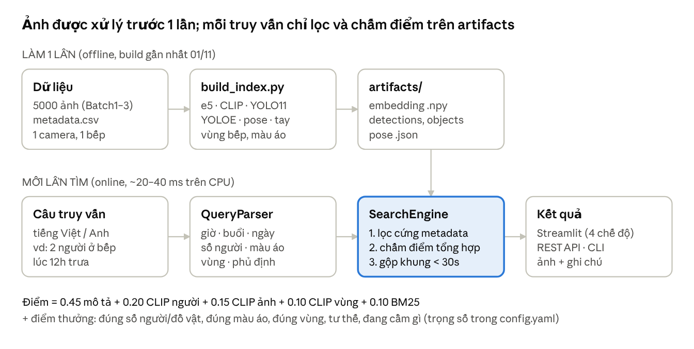

# Tình hình dự án Image Retrieval

10/11/2026 · Jenna

## Tổng quan

Mục tiêu: gõ một câu mô tả → trả về ảnh khớp trong bộ 5000 ảnh, lọc đúng theo giờ/buổi/ngày nếu câu có nhắc. Bản hiện tại dùng model pretrained; chỉ mục build gần nhất ngày 01/11/2026.

Ví dụ: `ba người đang nấu ăn lúc 12 giờ trưa` → nội dung "ba người đang nấu ăn" · giờ 12:00–12:59 · số người = 3.

**Dữ liệu cần biết trước khi làm:**

- 5000 ảnh, tất cả từ **1 camera cố định** nhìn từ trên xuống **1 căn bếp** (day1), từ 8h đến 20h, ảnh cách nhau khoảng 7–10 giây.
- `data/metadata.csv`: mỗi ảnh có `imageID`, `owner`, `day`, `hour`, `frame`, `class_count` (số người), `description` (câu mô tả).
- Vì ảnh nào cũng gần giống nhau (cùng góc, cùng bếp), so cả ảnh không đủ phân biệt → nhóm phải nhìn vào **từng người**, **từng vùng trong bếp** và **đồ vật nhỏ**. Đây là lý do có nhiều module nhận diện ở dưới.
- Ảnh gốc **không nằm trong repo**: `paths.image_root` trong `config.yaml` đang trỏ tới thư mục drive-download trên máy Jenna. Mỗi người cần sửa dòng này cho đúng máy mình.

## Kiến trúc và luồng xử lý



Chạy model trên 5000 ảnh làm một lần và lưu vào `artifacts/`; khi tìm, hệ thống chỉ mã hoá câu truy vấn rồi so trên toàn bộ 5000 ảnh bằng numpy. Giờ/ngày/địa điểm là **lọc cứng** (kết quả luôn đúng điều kiện); số người, màu áo, vị trí chỉ **cộng điểm** vì YOLO có thể đếm lệch.

## Hiện trạng các phần

Các phần dưới đây hiện có trong code, dữ liệu build lưu ở `artifacts/` (khoảng 4.600 dòng code Python). Mỗi phần nhận diện mới đều **tắt được bằng 1 dòng** `enabled: false` trong `config.yaml`, không cần build lại.

**Tóm tắt hiện trạng:**

- **Model:** dùng nguyên các model pretrained (zero-shot): multilingual-e5-base, CLIP XLM-R, YOLO11, YOLOE, YOLO-pose. **Chưa huấn luyện hay fine-tune model nào.**
- **Hiểu câu:** tự viết parser (regex + từ điển) cho tiếng Việt/Anh: giờ, số người, màu áo, vị trí, phủ định, tách vế câu.
- **Thích nghi với bộ ảnh:** vì camera cố định nên cắt từng người và từng vùng ra để chạy CLIP, chia vùng trong bếp theo điểm chân, bỏ câu mô tả chỉ tả nội thất, gộp khung hình gần nhau.
- **Kết hợp điểm:** lọc cứng theo metadata + tổng có trọng số của 5 nguồn + điểm thưởng. Trọng số và ngưỡng đặt tay hoặc bằng Otsu, không phải học từ dữ liệu.
- **Tính năng thêm:** chuỗi sự kiện (quy hoạch động), tìm người giống, tìm ảnh liên quan.
- **Bản demo hiện có:** giao diện Streamlit, REST API, CLI, bộ test, script đánh giá.
- **Dữ liệu:** đã tìm ra và phân nhóm 2.399 ảnh có metadata nghi sai, chưa sửa.

Chi tiết từng phần và file tương ứng ở các bảng dưới.

### 1. Hiểu câu truy vấn

| Phần | Làm gì | File |
| --- | --- | --- |
| Từ điển | Từ VI/EN cho đồ vật, địa điểm, buổi, số đếm, vùng trong bếp, màu áo | `src/retrieval/query/lexicon.py` |
| Bộ phân tích câu | Tách câu thành: giờ ("9h", "3 rưỡi chiều", "từ 9 đến 11h"), số người ("ít nhất 2", "không có ai"), màu áo, vị trí, phủ định theo từng vế câu; phần còn lại là nội dung để so nghĩa | `src/retrieval/query/parser.py` |

### 2. Mã hoá và chỉ mục

| Phần | Làm gì | File / kết quả |
| --- | --- | --- |
| Đọc dữ liệu | Đọc CSV, ghép tên file `08_509.jpg` ↔ `day1_Kitchen_08_509` | `data/catalog.py` |
| Embedding mô tả | multilingual-e5-base; bỏ câu chỉ tả nội thất, embed cả đoạn và từng câu | `text_emb.npy`, `sent_emb.npy` |
| CLIP toàn ảnh | CLIP đa ngôn ngữ XLM-R, so thẳng câu tiếng Việt với ảnh | `clip_img_emb.npy` |
| BM25 / TF-IDF | Bắt từ hiếm khi gõ tiếng Anh; TF-IDF dùng cho chế độ chạy không cần model | `index/bm25.py`, `tfidf.pkl` |
| Build | Chạy từng bước, bước nào đã có thì bỏ qua | `scripts/build_index.py`, `index/store.py` |

### 3. Nhận diện trong ảnh

| Phần | Làm gì | File |
| --- | --- | --- |
| YOLO11 | Đếm người và 80 loại đồ vật COCO, kèm khung | `vision/detector.py` → `detections.json` |
| CLIP ảnh cắt | CLIP cho từng người (\~12k người) và 3 vùng cố định: đảo bếp, bếp nấu, phòng khách | `vision/crops.py` → `person_emb.npy`, `region_emb.npy` |
| Vùng trong bếp | Từ điểm chân người → biết người đứng ở bếp nấu / bồn rửa / bàn ăn / sofa… | `scene/layout.py`, `docs/zones.jpg` |
| Màu áo | Gán vùng thân áo vào 11 màu cơ bản | `vision/colors.py` |
| YOLOE (PA2) | Nhận đồ vật nhỏ YOLO11 không có: dao, nồi, chảo, thớt, đĩa, cốc, điện thoại | `vision/objects.py` → `objects.json` |
| CLIP theo vùng (PA1) | Hỏi "có nồi trên bếp không" bằng CLIP trên vùng cắt | `clip_tags.npz` |
| YOLO-pose (PA2) | Khung xương → đứng / ngồi / cúi, và lấy màu áo theo vai–hông chính xác hơn | `vision/pose.py` → `pose.json` |
| Bàn tay (PA2) | Cắt ô quanh cổ tay → đoán đang cầm dao / điện thoại… | `vision/hands.py` → `hands_*.npy` |

### 4. Tìm kiếm, giao diện, kiểm thử

| Phần | Làm gì | File |
| --- | --- | --- |
| Search engine | Lọc cứng theo metadata, chấm điểm tổng hợp, gộp khung hình cách nhau < 30 giây | `search/engine.py`, `search/vision_extras.py` |
| Chuỗi sự kiện | "cắt dứa -> ngồi ăn" → tìm chuỗi ảnh đúng thứ tự thời gian | `features/temporal.py` |
| Ảnh liên quan / Tìm người này | Từ 1 ảnh hoặc 1 người → ảnh giống (theo ngoại hình + màu áo, không nhận khuôn mặt) | `features/similar.py` |
| Giao diện web | Streamlit, 4 chế độ: mô tả / chuỗi sự kiện / ảnh tương tự / theo người | `app/streamlit_app.py`, `app/ui.py` |
| REST API | FastAPI: `/search`, `/sequence`, `/similar`, `/person`, `/people`, `/image` | `app/api.py` |
| Dòng lệnh | Tìm bằng terminal | `scripts/search.py` |
| Test | Parser, màu áo, vùng, các phần PA1/PA2 | `tests/` (4 file) |
| Đánh giá | Recall@K, MRR, độ đúng metadata, độ trễ; `--compare`, `--ablation` | `eval/evaluate.py` |

### 5. Rà soát metadata

Đã so `metadata.csv` với kết quả YOLO và xem ảnh. Các cột `imageID`, `owner`, `day`, `hour`, `frame` đúng; **`class_count` và `description` có lỗi**. 2.399 ảnh nghi vấn đã được chia nhóm sẵn trong `metadata_review/` (xem mục Việc tiếp theo).

Khi mới nâng cấp nhận diện (01/11), bản code cũ được giữ trong `_backup_truoc_nang_cap_nhan_dien/`; thường chỉ cần tắt công tắc trong config, không cần chép đè.

## Việc tiếp theo

Việc trước mắt là **rà soát metadata bằng tay**: `metadata_review/review.csv` có 2.399 dòng, chưa dòng nào được điền. Việc này chia cho nhiều người được, không cần biết code.

| Nhóm (làm theo thứ tự này) | Số ảnh | Vấn đề | Cần làm |
| --- | --- | --- | --- |
| 01 Ảnh hiệu chuẩn | 50 | Ảnh lưới ô / chữ "CASTLE 2024 Dataset", không phải cảnh bếp | Lướt xác nhận, đánh `x` để loại |
| 05 Frame vượt 3600 | 11 | Ghi giờ 13 nhưng thật ra là 14:00–14:01 | Xác nhận để sửa giờ |
| 03 Mô tả nói có người, CSV và YOLO đều 0 | 547 | Phần lớn là mô tả bịa, đôi khi có người ở sofa bị sót | Ghi số người thật |
| 02 CSV và YOLO đếm lệch | 883 | YOLO sót người đang cúi (219) hoặc đếm nhiều hơn (664) | **Đếm tay**; gợi ý sẵn = max(CSV, YOLO) |
| 04 Mô tả đếm sai, CSV khớp YOLO | 908 | 98% là mô tả đếm thiếu | Có thể sửa tự động, không bắt buộc kiểm tay |

Cách điền: mở `review.csv` (hoặc `_danh_sach.csv` trong từng thư mục) bằng Excel, điền `so_nguoi_dung` (để trống = đồng ý gợi ý), `loai_khoi_du_lieu` (`x` = bỏ ảnh), `ghi_chu`. Ảnh trong thư mục đã vẽ sẵn khung người và số đếm để xem cho nhanh.

**Việc kỹ thuật tiếp theo:**

- [ ] Chạy `python eval/evaluate.py --compare` và `--ablation` trên máy có model để có số liệu trước/sau. Phần CLIP người/vùng và PA1/PA2 chưa được đo.
- [ ] Bổ sung truy vấn có nhãn: bộ đánh giá hiện chỉ có 14 + 15 truy vấn (`eval/*.jsonl`), quá ít để kết luận.
- [ ] Sau khi rà soát xong: cập nhật metadata, loại 50 ảnh hiệu chuẩn, build lại phần liên quan.
- [ ] Chỉnh ngưỡng CLIP vùng (`objects.clip_tags.thresholds`) sau khi kiểm khoảng 50 ảnh.
- [ ] Cải thiện luật tư thế đứng/ngồi/cúi (`vision/pose.py`), hiện còn thô nên trọng số thấp.

**Hạn chế đã biết:** dao nằm trên bàn không ai cầm vẫn hay sót; vùng bàn ăn/phòng khách mới chỉnh bằng mắt, chưa kiểm bằng số liệu.

## Chạy thử trên máy mình

Có sẵn thư mục `artifacts/` thì **không cần build lại**, chỉ cần cài và mở giao diện.

1. Tạo môi trường và cài gói:

```bash
python -m venv .venv
.venv\Scripts\activate
pip install -r requirements.txt
```

2. Sửa `paths.image_root` trong `config.yaml` trỏ tới thư mục chứa `Batch1/`, `Batch2/`, `Batch3/` trên máy mình.
3. Mở giao diện web: `streamlit run app/streamlit_app.py` (hoặc gõ ở terminal: `python scripts/search.py -i`).
4. Thử vài câu: `hai người đứng ở bếp nấu lúc 12 giờ trưa`, `người cầm dao lúc 16h`, `someone sitting on the couch in the evening`.
5. Trước khi gửi code: chạy `pytest` để chắc không làm hỏng parser hay phần nhận diện.

Nếu phải build lại (đổi model, đổi dữ liệu): `python scripts/build_index.py` chỉ chạy các bước còn thiếu; lần đầu trên CPU mất khoảng 30–45 phút, thêm \~1 giờ cho bước `tags,objects,pose,hands`. Muốn chỉnh trọng số hay bật/tắt tính năng thì sửa `config.yaml`, không cần sửa code. Chi tiết đầy đủ nằm trong `README.md` của repo.
